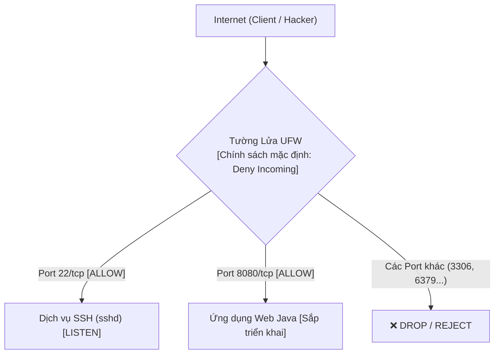

# Báo Cáo Bài Tập 3: Cấu Hình Tường Lửa UFW Và Chẩn Đoán Cổng Mạng

- **Môn học**: DevOps Fundamentals (IT-209)
- **Session**: 06 - Linux Administration, Permissions & Process Management
- **Bài tập**: Bài 3 - Cấu hình tường lửa UFW và chẩn đoán cổng mạng
- **Đường dẫn nộp bài trên GitHub**: `homework/session_06/ex3/`
- **Học viên**: HoQuocKhai
- **Email**: khaiho6040@gmail.com

---

## 1. Mục tiêu bài thực hành
1. **Quản trị tường lửa UFW (Uncomplicated Firewall)**: Nắm vững nguyên lý hoạt động của UFW trong việc kiểm soát các gói tin mạng ra/vào máy chủ Linux.
2. **Thiết lập chính sách bảo mật Zero Trust (Default Deny)**: Khóa toàn bộ các kết nối từ bên ngoài vào hệ thống, chỉ mở các cổng dịch vụ thực sự cần thiết.
3. **Mở cổng dịch vụ an toàn**: Mở cổng 22/tcp (SSH) phục vụ quản trị và cổng 8080/tcp cho ứng dụng Web.
4. **Chẩn đoán mạng bằng `ss`**: Sử dụng công cụ socket statistics (`ss -tlnp`) để kiểm tra các cổng mạng đang thực sự ở trạng thái lắng nghe (LISTEN).

---

## 2. Cơ sở lý thuyết: Tường lửa và Socket mạng

### 2.1. Phân biệt Chính sách Tường lửa (UFW) và Trạng thái Lắng nghe (ss)


- **UFW (Firewall Rules)**: Đóng vai trò là chốt bảo vệ ở tầng biên mạng. Dù cổng ứng dụng có mở hay không, UFW quyết định gói tin từ IP bên ngoài có được phép chạm tới hệ điều hành hay không.
- **`ss -tlnp` (Socket Statistics)**: Cho biết tiến trình (Process) nào trên máy chủ đang mở cổng để "đón khách" (LISTEN).
  - Cổng 22: Có tiến trình `sshd` đang lắng nghe.
  - Cổng 8080: Đã được mở trên UFW, sẵn sàng đón kết nối khi ứng dụng Web được khởi chạy.

---

## 3. Quá trình thực hiện chi tiết

### Bước 1: Thiết lập chính sách mặc định (Default Policies)
Thiết lập chính sách chặn toàn bộ kết nối đi vào và cho phép kết nối đi ra:
```bash
sudo ufw default deny incoming
sudo ufw default allow outgoing
```
**Kết quả thực tế:**
```text
devops@1161186107523368:~$ sudo ufw default deny incoming
Default incoming policy changed to 'deny'
(be sure to update your rules accordingly)
devops@1161186107523368:~$ sudo ufw default allow outgoing
Default outgoing policy changed to 'allow'
(be sure to update your rules accordingly)
```

---

### Bước 2: Khai báo quy tắc mở cổng SSH và ứng dụng Web
Mở cổng 22/tcp và 8080/tcp:
```bash
sudo ufw allow 22/tcp
sudo ufw allow 8080/tcp
```
**Kết quả thực tế:**
```text
devops@1161186107523368:~$ sudo ufw allow 22/tcp
Rules updated
Rules updated (v6)
devops@1161186107523368:~$ sudo ufw allow 8080/tcp
Rules updated
Rules updated (v6)
```

---

### Bước 3: Kích hoạt tường lửa UFW
Kích hoạt tường lửa chạy ngầm và tự khởi động cùng hệ thống:
```bash
sudo ufw enable
```
**Kết quả thực tế:**
```text
devops@1161186107523368:~$ sudo ufw enable
Command may disrupt existing ssh connections. Proceed with operation (y|n)? y
Firewall is active and enabled on system startup
```

---

## 4. Kết quả kiểm tra và chẩn đoán hệ thống

### 4.1. Kiểm tra trạng thái chi tiết của UFW (`sudo ufw status verbose`)
```bash
devops@1161186107523368:~$ sudo ufw status verbose
```
**Kết quả chi tiết:**
```text
Status: active
Logging: on (low)
Default: deny (incoming), allow (outgoing), disabled (routed)
New profiles: skip

To                         Action      From
--                         ------      ----
22/tcp                     ALLOW IN    Anywhere                  
8080/tcp                   ALLOW IN    Anywhere                  
22/tcp (v6)                ALLOW IN    Anywhere (v6)             
8080/tcp (v6)              ALLOW IN    Anywhere (v6)             
```

---

### 4.2. Chẩn đoán các cổng TCP đang lắng nghe (`ss -tlnp`)
Kiểm tra các socket TCP đang mở trên máy chủ:
```bash
devops@1161186107523368:~$ ss -tlnp
```
**Kết quả chi tiết:**
```text
State               Recv-Q               Send-Q                             Local Address:Port                             Peer Address:Port              Process              
LISTEN              0                    4096                               127.0.0.53%lo:53                                    0.0.0.0:*                                      
LISTEN              0                    4096                                     0.0.0.0:22                                    0.0.0.0:*                                      
LISTEN              0                    4096                                  127.0.0.54:53                                    0.0.0.0:*                                      
LISTEN              0                    4096                                        [::]:22                                       [::]:*                                      
```

**Phân tích kết quả `ss -tlnp`:**
- Cổng **`22`** (SSH): Đang ở trạng thái `LISTEN` trên cả IPv4 (`0.0.0.0:22`) và IPv6 (`[::]:22`), khớp với quy tắc mở cổng `22/tcp` trên UFW giúp kết nối quản trị luôn thông suốt.
- Cổng **`53`**: Dịch vụ phân giải tên miền cục bộ `systemd-resolved` chạy nội bộ trên Loopback (`127.0.0.53`, `127.0.0.54`), không bị lộ ra ngoài Internet.
- Cổng **`8080`**: Đã được tường lửa mở sẵn, khi triển khai ứng dụng Web ở các bước tiếp theo, tiến trình sẽ lắng nghe và phục vụ người dùng bình thường.

---

## 5. Kết luận
- Tường lửa UFW đã được thiết lập đúng chuẩn an ninh mạng cho máy chủ Cloud VPS: chặn tất cả đầu vào, mở có kiểm soát cổng SSH và cổng Web.